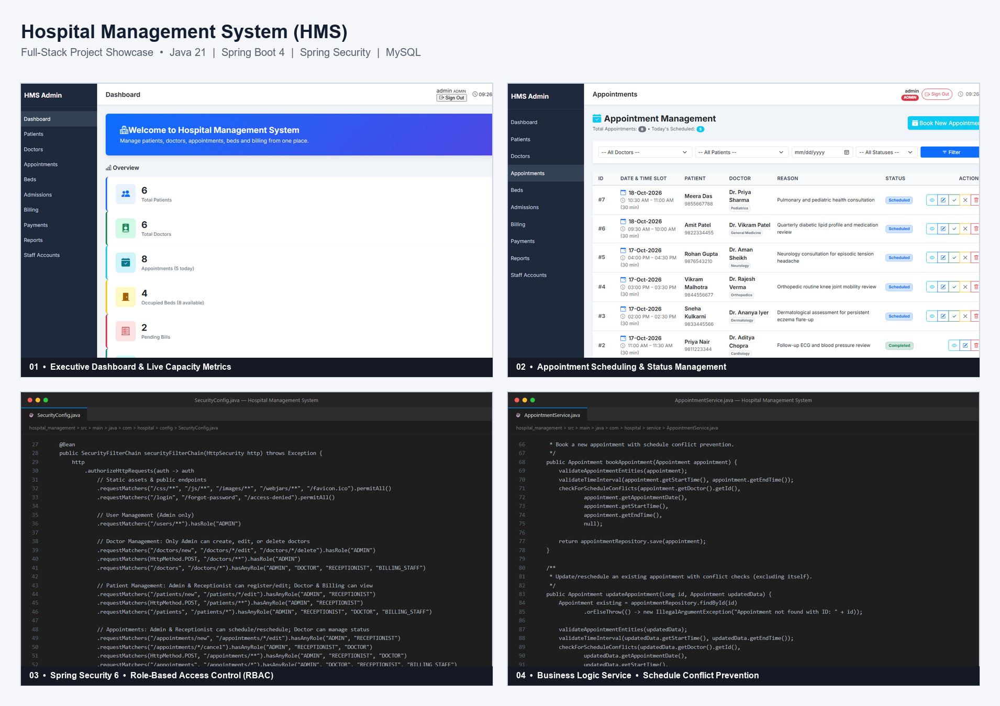
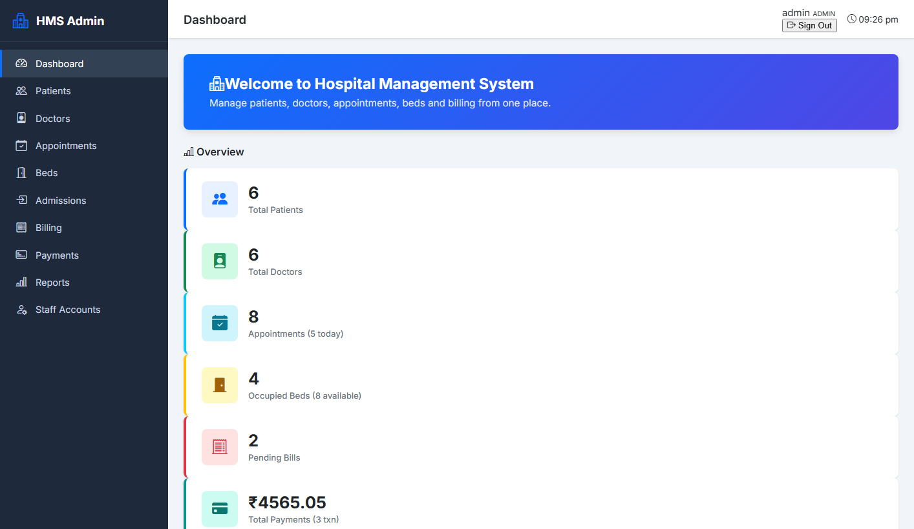
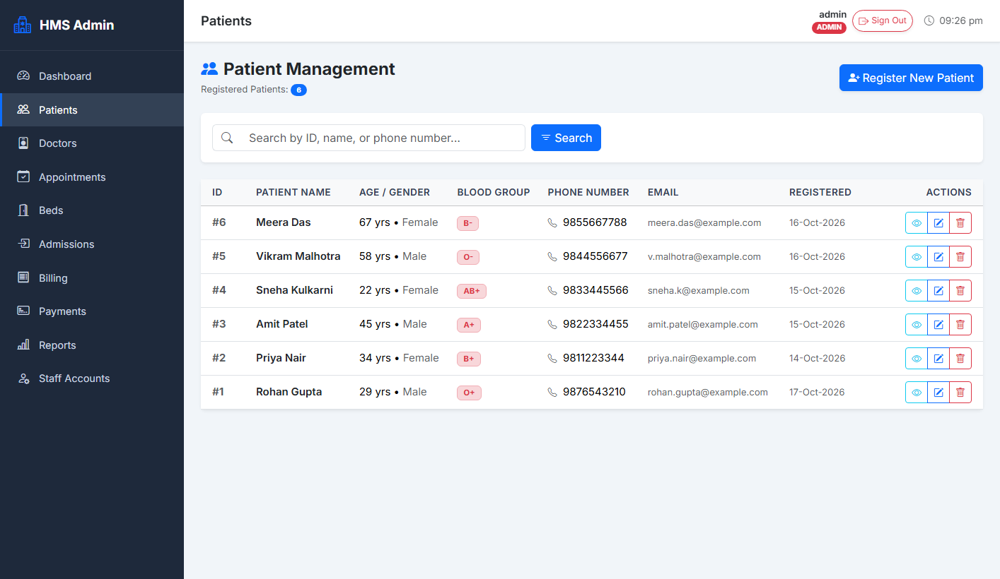
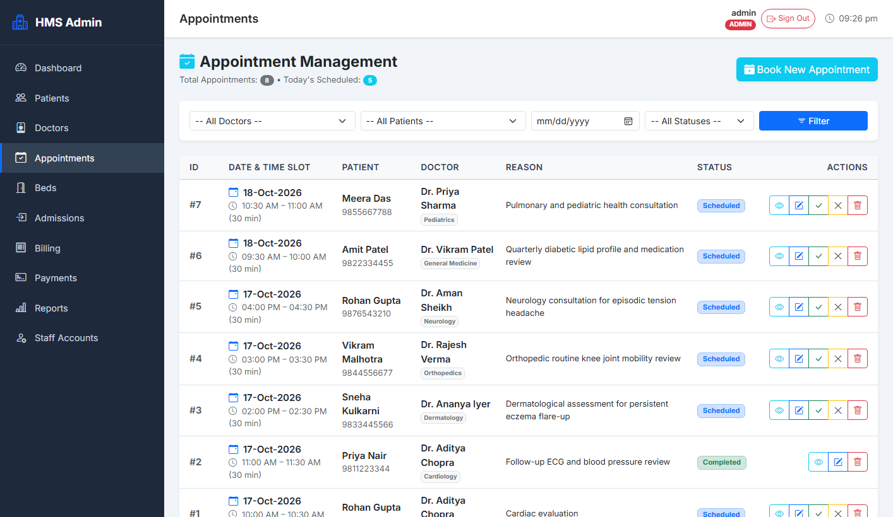

# Hospital Management System (HMS)

A full-stack Hospital Management System designed for healthcare administration, inpatient bed allocation, appointment scheduling, billing, and clinical analytics. Developed as a college Project-Based Learning (PBL) software engineering mini-project using **Java 21**, **Spring Boot**, **Spring Security**, **Thymeleaf**, and **MySQL**.

---

## Project Overview

The objective of this project is to streamline hospital operational workflows through a single web portal. The system coordinates patient registration, physician scheduling, inpatient ward management, billing, and payment tracking with strict Role-Based Access Control (RBAC).

### Key Modules

- **Executive Dashboard:** High-level metrics for active patient count, available vs. occupied beds, scheduled appointments, pending invoices, and settled revenue.
- **Patient Management:** Standardized patient registration with Jakarta Bean Validation (demographics, contact validation, medical background) and searchable patient directory.
- **Doctor Directory & Schedules:** Specialty tracking, department assignment, consultation fees, and weekly consultation schedules.
- **Appointment Scheduling:** Conflict prevention to prevent double bookings, status lifecycles (`SCHEDULED`, `COMPLETED`, `CANCELLED`), and single-click invoice generation.
- **Inpatient Bed & Ward Management:** Real-time ward tracking across ward types (`GENERAL`, `SEMI_PRIVATE`, `PRIVATE`, `ICU`, `EMERGENCY`). Uses database row-level locking (`PESSIMISTIC_WRITE`) to avoid race conditions during concurrent bed allocations.
- **Admission & Discharge:** Attending physician assignment, inpatient bed assignment, bed discharge release, and automated billing synchronization.
- **Invoicing & Billing:** Sequential invoice formatting (`INV-YYYYMMDD-XXXX`), itemized diagnostic and ward tariffs, tax and discount computations, and printable invoice statements.
- **Payment Processing:** Multi-channel payment recording (`CASH`, `CARD`, `UPI`, `BANK_TRANSFER`) with real-time balance calculations.
- **Role-Based Access Control (RBAC):** Spring Security integration protecting routes and actions according to staff duties:
  - `ROLE_ADMIN`: User management, credential resets, and full system administration.
  - `ROLE_DOCTOR`: Access to patient medical records and personal appointment schedules.
  - `ROLE_RECEPTIONIST`: Patient intake, outpatient appointment booking, and ward admissions.
  - `ROLE_BILLING_STAFF`: Invoice generation, payment receipt collection, and financial tracking.
- **Reports & Analytics:** Filterable operational summaries for appointments, patient demographics, ward occupancy rates, and revenue collection.

---

## Application Showcase

### System Overview & Highlights


### Core Interface Previews

| Executive Dashboard | Patient Directory |
| :---: | :---: |
|  |  |

| Outpatient Appointment Scheduling |
| :---: |
|  |

---

## Technology Stack

| Layer | Technologies |
| :--- | :--- |
| **Language** | Java 21 (LTS) |
| **Framework** | Spring Boot 4.x (Spring Framework 7.x) |
| **Security** | Spring Security (BCrypt password encoding, CSRF protection, session management) |
| **Persistence** | Spring Data JPA / Hibernate (ORM, row locking, schema auto-generation) |
| **Database** | MySQL 8.0+ (Development & Production), H2 Database (Test scope) |
| **Template Engine** | Thymeleaf with Spring Security Extras Dialect |
| **Frontend** | HTML5, CSS3, Vanilla JavaScript, Bootstrap 5.3, Bootstrap Icons |
| **Testing** | JUnit 5, Mockito, Spring Boot MockMvc (213 automated tests) |
| **Build & Packaging** | Apache Maven with Maven Wrapper (`mvnw` / `mvnw.cmd`) |
| **Containerization** | Docker (Multi-stage build with Eclipse Temurin JDK 21 / JRE 21 Jammy) |
| **Deployment** | Render Web Service (Docker runtime with managed environment variables) |

---

## Repository Structure

```text
Hospital_management/
├── .mvn/
│   └── wrapper/
│       ├── maven-wrapper.jar
│       └── maven-wrapper.properties
├── screenshots/                     # Application screenshots and showcase graphics
│   ├── appointments.png
│   ├── dashboard.png
│   ├── patient-management.png
│   └── project-showcase.png
├── scripts/                         # Maintenance and helper scripts
│   └── generate_screenshots.py      # Automated screenshot and code card generator
├── sql/                             # SQL scripts
│   └── populate_demo_data.sql       # Reference demo dataset for manual import
├── src/
│   ├── main/
│   │   ├── java/com/hospital/hospital_management/
│   │   │   ├── config/              # SecurityConfig, DemoDataInitializer, SecurityDataInitializer
│   │   │   ├── controller/          # Spring MVC Web Controllers
│   │   │   ├── dto/report/          # Data Transfer Objects for analytics
│   │   │   ├── model/               # JPA Entities and Enums
│   │   │   ├── repository/          # Spring Data JPA Repositories
│   │   │   └── service/             # Service layer implementations & UserDetailsService
│   │   └── resources/
│   │       ├── static/              # CSS styling and JavaScript assets
│   │       ├── templates/           # Thymeleaf HTML view templates
│   │       └── application.properties # Main application configuration
│   └── test/                        # Complete automated test suite (213 tests)
├── .dockerignore                    # Docker build context exclusions
├── .gitattributes                   # Git cross-platform line ending normalization
├── .gitignore                       # Git exclusions (build artifacts, IDE files, secrets)
├── Dockerfile                       # Multi-stage production Dockerfile
├── mvnw                             # Maven wrapper for Linux/macOS
├── mvnw.cmd                         # Maven wrapper for Windows
├── pom.xml                          # Maven build dependencies and plugins
└── README.md                        # Project documentation
```

---

## Prerequisites

Before running the application locally, make sure you have:

- **Java Development Kit (JDK):** Version 21 or higher installed and added to `PATH`.
- **MySQL Server:** Version 8.0 or higher running locally on port `3306`.
- **Git:** Version control client.

*(Maven is included in the project via the Maven Wrapper; a separate Maven installation is not required).*

---

## Local Setup & Installation

### 1. Clone the Repository

```bash
git clone https://github.com/amansheikh-techie/Hospital-management-system.git
cd Hospital-management-system
```

### 2. Configure MySQL Database

Open MySQL command line or MySQL Workbench and create the database:

```sql
CREATE DATABASE IF NOT EXISTS hospital_db;
```

### 3. Configure Environment Variables

The application reads credentials from environment variables to keep sensitive configuration out of source control. Configure your local database values:

**Windows PowerShell:**
```powershell
$env:DB_URL="jdbc:mysql://localhost:3306/hospital_db?useSSL=false&allowPublicKeyRetrieval=true&serverTimezone=Asia/Kolkata"
$env:DB_USERNAME="root"
$env:DB_PASSWORD="your_mysql_password"
$env:ADMIN_INITIAL_PASSWORD="YourSecurePassword123!"
```

**Linux / macOS:**
```bash
export DB_URL="jdbc:mysql://localhost:3306/hospital_db?useSSL=false&allowPublicKeyRetrieval=true&serverTimezone=Asia/Kolkata"
export DB_USERNAME="root"
export DB_PASSWORD="your_mysql_password"
export ADMIN_INITIAL_PASSWORD="YourSecurePassword123!"
```

*Note: If `DB_USERNAME` and `DB_PASSWORD` are not explicitly set, the application defaults to username `root` with an empty password.*

### 4. Build and Run the Application

Using the included Maven Wrapper:

**Windows PowerShell:**
```powershell
.\mvnw.cmd "-Djava.net.preferIPv4Stack=true" spring-boot:run
```

**Linux / macOS:**
```bash
./mvnw -Djava.net.preferIPv4Stack=true spring-boot:run
```

Once the application finishes starting up, open your web browser and navigate to:
👉 **[http://localhost:8080](http://localhost:8080)**

---

## Initial Accounts & Demo Data

The application includes an automated seeder (`DemoDataInitializer.java`) that checks the database upon startup in non-test profiles:

- **If the database is empty:** It automatically seeds essential demo doctors, patients, wards, sample admissions, appointments, and bills for immediate review.
- **Admin Account:** Username is `admin`. The password will match whatever you provided in `ADMIN_INITIAL_PASSWORD` (or fallback `AdminPass123!` if left blank during local demo setup).
- **Staff Demo Accounts:** Pre-seeded for testing role-specific interfaces:
  - Receptionist: `receptionist` / `AdminPass123!`
  - Billing Staff: `billing` / `AdminPass123!`
  - Doctor: `dr.aditya` / `AdminPass123!`

An alternative manual SQL seed file is also available at [sql/populate_demo_data.sql](sql/populate_demo_data.sql).

---

## Running with Docker

The repository includes a multi-stage `Dockerfile` based on Eclipse Temurin JDK 21 (build stage) and JRE 21 Jammy (runtime stage).

### Build the Docker Image

```bash
docker build -t hospital-management-system:latest .
```

### Run the Container

```bash
docker run -d \
  --name hospital-app \
  -p 8080:8080 \
  -e DB_URL="jdbc:mysql://host.docker.internal:3306/hospital_db?useSSL=false&allowPublicKeyRetrieval=true&serverTimezone=Asia/Kolkata" \
  -e DB_USERNAME="root" \
  -e DB_PASSWORD="your_mysql_password" \
  -e ADMIN_INITIAL_PASSWORD="YourSecurePassword123!" \
  hospital-management-system:latest
```

---

## Deployment on Render

This project is configured for direct deployment as a Docker Web Service on [Render](https://render.com/) with an external managed MySQL database (e.g. Aiven, Railway, AWS RDS, or PlanetScale):

1. **Database:** Create a managed MySQL 8.0+ instance and copy its connection details.
2. **Create Service:** In the Render Dashboard, create a **New Web Service** and connect this repository.
3. **Environment / Runtime:** Select **Docker** (Render will detect the root `Dockerfile`).
4. **Environment Variables:** Under the service's **Environment** tab, set:

| Variable | Required | Description | Example |
| :--- | :---: | :--- | :--- |
| `DB_URL` | **Yes** | JDBC connection string | `jdbc:mysql://<host>:<port>/<dbname>?useSSL=true&serverTimezone=UTC` |
| `DB_USERNAME` | **Yes** | Database username | `avnadmin` |
| `DB_PASSWORD` | **Yes** | Database password | `<your_secure_password>` |
| `ADMIN_INITIAL_PASSWORD` | **Yes** | Initial password for the admin account | `<your_admin_password>` |
| `DDL_AUTO` | Optional | Hibernate DDL strategy (default: `update`) | `update` |
| `THYMELEAF_CACHE` | Optional | Template caching toggle (default: `false`) | `true` |

*(Note: Render automatically sets and passes the `PORT` variable to the Docker container).*

---

## Automated Testing & Validation

The application contains an automated test suite verifying web controllers, business services, database operations, and security constraints. Tests run in an isolated in-memory H2 database, requiring no external MySQL server.

To run the full test suite:

**Windows PowerShell:**
```powershell
.\mvnw.cmd test
```

**Linux / macOS:**
```bash
./mvnw test
```

### Test Suite Summary

- **Total Tests:** 213
- **Failures / Errors:** 0
- **Coverage Areas:**
  - **Controller Slice Tests (`@WebMvcTest`):** Request routing, view model attributes, validation triggers, and HTTP status codes for Patients, Doctors, Appointments, Beds, Admissions, Bills, Payments, Reports, and Users.
  - **Service Unit Tests (`Mockito`):** Schedule conflict algorithms, pessimistic bed locking, billing recalculations, balance deductions, and user credential management.
  - **Security Configuration Tests:** URL permission matrices across roles (`ROLE_ADMIN`, `ROLE_DOCTOR`, `ROLE_RECEPTIONIST`, `ROLE_BILLING_STAFF`), login workflows, and unauthorized redirect verification.

---

## License & Academic Disclaimer

This project was developed as a software engineering mini-project for College Project-Based Learning (PBL). It is designed for educational, demonstration, and portfolio purposes.
